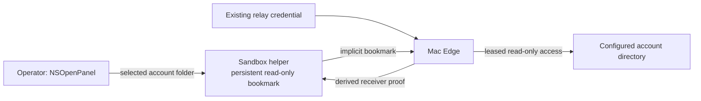

# Authorized macOS source-folder access

This procedure is for one already configured local macOS WeChat account. It does
not discover accounts, widen source or egress policy, write Keychain material, or
start the Edge. Authorization reads the existing Edge relay credential through
its SecretStore reference and derives a purpose-separated receiver proof; the
relay credential never leaves Python. No new Keychain item or ACL is created.
Grant-only and a new shadow settings file can be prepared while the existing
runtime remains active. The command never replaces existing Edge settings.

The database root in native settings is `<xwechat_files>/<account>/db_storage`.
The helper requests access to the single account directory
`<xwechat_files>/<account>`, which covers the database directory and ordinary
attachments. It never requests `<xwechat_files>` or another account.

The source design separates the stored capability from the process using it.
The helper owns no database keys, message processing, WindowDB or capture ACK.



The initial grant is interactive. Later authenticated leases resolve without UI;
the receiver explicitly starts access once and releases it on all completion/failure
paths. The helper stays alive until the receiver's source lifetime ends.
This follows [Apple's file-access and bookmark model](https://developer.apple.com/documentation/security/accessing-files-from-the-macos-app-sandbox).

## Build and check

Build at a new absolute path inside a caller-owned private directory. Existing
files, directories and symlinks are rejected; the script does not replace a granted
helper or change an existing parent's permissions. The script compiles, ad-hoc signs,
and verifies the app-scope bookmark, user-selected read-only, and App Sandbox
entitlements. It does not install, launch, open a picker, alter TCC, or fetch
anything.

```bash
SOURCE_ACCESS_APP="$PRIVATE_HELPER_DIR/SightglassSourceAccess.app"
scripts/build-source-access-helper.sh "$SOURCE_ACCESS_APP"
sightglassctl source-access check --helper "$SOURCE_ACCESS_APP"
```

`check` is a non-granting installation check, not an authenticated capability check,
and never exports a bookmark. Runtime exports require the stored receiver verifier
to match the derived proof. An ad-hoc signature preserves a fixed local helper
identity only as well as the installation and signing arrangement do; it is not
proof that TCC will retain access across every rebuild or installation.

## Review the exact scope

```bash
sightglassctl source-access preview --settings "$EDGE_SETTINGS"
```

The preview derives the account directory from the unchanged configured
`source_root`. It reports only path classes and an opaque identity digest.

Sticker-key derivation also reads these two exact shared files:

```text
<xwechat_files>/all_users/config/global_config
<xwechat_files>/all_users/config/global_config.crc
```

To authorize those optional files, pass `--include-shared-config`. Without that
grant, helper mode injects an unavailable sticker decoder and does not attempt
the shared read. Ordinary text, resource, image and voice paths continue to use
the single account grant and the original Keychain references.

## Authorize

The explicit picker opens only from this operator command. A cancellation or
scope mismatch grants nothing and leaves stored capability state untouched.

```bash
sightglassctl source-access authorize \
  --settings "$EDGE_SETTINGS" \
  --helper "$SOURCE_ACCESS_APP"
```

Add `--include-shared-config` to request both exact shared files. The account
folder and optional shared files are committed as one atomic capability
envelope in the helper's private app container. Bookmark bytes use private
pipes and memory and are never printed.

Bookmark exports and response encoding are prepared before capability publication.
A failure once publication starts, including replace/move, directory sync or lost
response, can leave either the old or the new grant. The helper reports local
publication/durability failure as `source_access_capability_publication_uncertain`;
it is not proof of revocation or of an unchanged before-image. The Edge settings
remain unchanged unless the separate binding step succeeds. Do not automatically
reopen the picker or overwrite an uncertain grant as error recovery.

The default command is grant-only: `$EDGE_SETTINGS` stays byte-for-byte
unchanged. This also permits preparation while an older Edge is still active.

## Prepare the new Edge settings

Use a new private shadow path while retaining the current runtime:

```bash
sightglassctl source-access authorize \
  --settings "$EDGE_SETTINGS" \
  --helper "$SOURCE_ACCESS_APP" \
  --output "$NEW_EDGE_SETTINGS" \
  --bind
```

The command rechecks the Edge and native settings before-images, validates the
helper identity and digest, and writes only the shadow file. It preserves the
native settings, account/profile bindings, egress ceiling, stream/origin epochs,
pending spool and activation ownership. The coordinator switches the stopped
Edge to that exact shadow file during the authorized transition.

Binding requires `--bind` and a new `--output` shadow file; an existing target,
the current settings path, or an unsafe parent fails before the picker opens.
The binding fails closed on concurrent Edge/native settings changes. It performs
no source read, spool reset, Keychain write or Edge start. Runtime/config selection
remains a separate stopped operator action.

## Runtime behavior

Runtime resolution is noninteractive. The helper resolves its app-scoped
bookmark without UI and returns implicit bookmark bytes over the bounded pipe.
PyObjC resolves those in the Edge process, verifies the exact account directory
and optional exact shared-file identities, then holds their security scopes for
the complete provider lifetime. Missing, stale, mismatched or unsupported
grants fail closed; manual reads are not used as a fallback.

Source completion, a compiled helper, a real picker grant, retained access
after restart, and a second-process drill are separate facts. Non-granting sandbox
checks and the compiled Swift/Python protocol harness do not certify a real folder
grant or persistent cross-process access. Those require a separate owner-authorized
acceptance on the target Mac.
